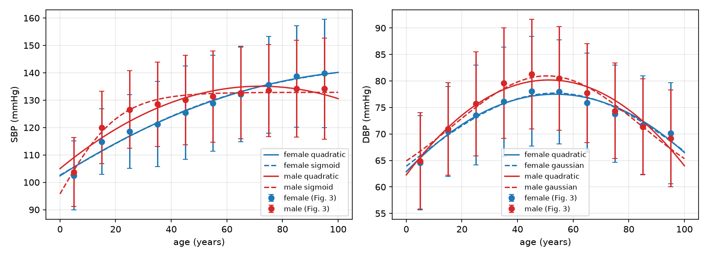
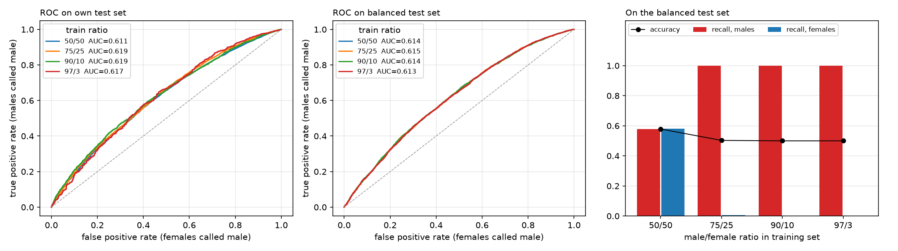

# HW7_KLAUDEL_BMI500
# HW7_KLAUDEL_BMI500
  
  ---
  Name: Barbara Klaudel
  Email: barbara.klaudel@emory.edu
  Question: HW3
  ---

  ## Quickstart
  `
  uv sync
  `

  # Part A  

  ## Methods

  Table 3 contents were OCRed with Claude to convert the data to CSV.
  Table 3 reports the mean and std values for different age bins. The values for each sex group were interpolated with Claude from Figure 3.

  Three models were used to predict SBP and DBP:
  - The Polynomial model for SBP and DBP
    $$SBP(a) = c_1 a^2 + c_2 a + c_3, \qquad DBP(a) = d_1 a^2 + d_2 a + d_3$$
  - The sigmoid model for SBP $$SBP(a) = S_0 + \frac{\Delta S}{1 + e^{-k(a-a_0)}}$$
  - The Gaussian model for DBP $$DBP(a) = D_0 + \Delta D\, e^{-\frac{(a-a_{peak})^2}{2\sigma^2}}$$

  The quadratic coefficients are fitted by linear least squares (normal equations on the design matrix [a**2 + a +1]].'

  The sigmoid and Gaussian parameters are fitted by bounded nonlinear least squares. The bounds keep the valuses in the plausible range.

  ## Results

  ### Fitted parameters
  | Sex |  BP | Model | params |
  | -- | -- | -- | -- |
  | female |	SBP	| quadratic |	c1 = −0.0027 mmHg/yr², c2 = 0.648 mmHg/yr, c3 = 102.4 mmHg
  | female |	SBP |	sigmoid	| S0 = 60.2 mmHg, ΔS = 84.9 mmHg, k = 0.028 /yr, a0 ≈ 0 yr (at lower bound) |
  | female	| DBP	| quadratic |	d1 = −0.0051 mmHg/yr², d2 = 0.546 mmHg/yr, d3 = 62.9 mmHg |
  | female |	DB |	gaussian |	D0 = 40.0 mmHg (at lower bound), ΔD = 37.7 mmHg, a_peak = 53.5 yr, σ = 56.0 yr |
  | male |	SBP |	quadratic |	c1 = −0.0058 mmHg/yr², c2 = 0.836 mmHg/yr, c3 = 105.0 mmHg |
  | male	| SBP	| sigmoid |	S0 = 58.7 mmHg, ΔS = 74.2 mmHg, k = 0.094 /yr, a0 ≈ 0 yr (at lower bound) |
  | male |	DBP | 	quadratic	| d1 = −0.0068 mmHg/yr², d2 = 0.699 mmHg/yr, d3 = 62.3 mmHg |
  | male |	DBP	| gaussian |	D0 = 57.1 mmHg, ΔD = 23.9 mmHg, a_peak = 50.6 yr, σ = 33.9 yr |

  ## Goodness of fit nd model selection
  k -- no. of params
  | sex |	BP |	model |	k |	MSE (mmHg²) |	R² |	AIC |	AICc |	BIC |
  |---|---|---|---|---|---|---|---|---|
  female |	SBP |	quadratic |	3	| 2.62 |	0.979 |	15.6 |	19.6 |	16.5 |
  | female |	SBP	| sigmoid	| 4 |	2.83	| 0.977	| 18.4 |	26.4 |	19.6 |
  | female | DBP |	quadratic |	3	| 0.76	| 0.951 |	3.3 |	7.3 |	4.2 |
  | female | DBP |	gaussian |	4	| 0.83 |	0.947	| 6.2	 | 14.2 |	7.4 |
  | male	 | SBP |	quadratic |	3 |	7.97 |	0.900  |	26.8 |	30.8 |	27.7 |
  | male	 | SBP |	sigmoid |	4 |	1.46 |	0.982 |	11.8 |	19.8 |	13.0 |
  | male   |	DBP |	quadratic |	3 |	1.46 | 	0.944 |	9.8 |	13.8	| 10.7 |
  | male	 | DBP | gaussian	| 4 |	1.19 |	0.955	| 9.7 |	17.7 |	10.9 |

Definitions: 
* $MSE = RSS/n$,
* $R^2 = 1 − RSS/TSS$,
* $AIC = n·ln(RSS/n) + 2k$,
* $AICc = AIC + 2k(k+1)/(n−k−1)$,
* $BIC = n·ln(RSS/n) + k·ln(n)$

Best model per criterion
|criterion |	female SBP |	female DBP |	male SBP  | male DBP |
|---|---|---|---|---|
| MSE |	quadratic	| quadratic |	sigmoid |	gaussian |
| AIC	| quadratic |	quadratic |	sigmoid |	gaussian |
| AICc |	quadratic	| quadratic	| sigmoid |	quadratic |
| BIC	| quadratic |	quadratic |	sigmoid |	 quadratic| 

### Parameter interpretation
**Quadratic model**
* $c1$, $d1$, (mmHg/yr2) are the curvature terms. All four are negative, so every curve is concave: blood pressure rises with age, but the rise slows down. The vertex a* = −c2/(2c1) is the age at which the parabola turns over: 120 yr for female SBP (outside the data, so SBP keeps rising over the whole range), 72 yr for male SBP (the model's way of representing the male plateau), 53.5 yr for female DBP and 51.3 yr for male DBP (the DBP peak).
* $c2$, $d2$ (mmHg/yr) are the slopes at age 0, i.e. the initial rate of rise. Males rise faster (0.84 vs 0.65 mmHg/yr for SBP, 0.70 vs 0.55 for DBP).
* $c3$, $d3$ (mmHg) are the intercepts, i.e. the extrapolated blood pressure at age 0 (105 vs 102 mmHg for SBP; about 62 mmHg DBP for both sexes).

**Sigmoid model (SBP)**

* S_0 (mmHg is the lower asymptote and $S_0 + \delta S(mmHg) the upper one: 145 mmHg for females and 133 mmHg for males.
* $\delta_S$ (mmHg) is the total rise over life, larger in females (85 vs 74 mmHg).
* $k$ 1/yr) is the steepness of the rise. The male rise is three times steeper (0.094 vs 0.028 /yr, time constants 1/k of about 11 vs 36 yr), so the male curve is practically flat at 133 mmHg from about 50 yr on, whereas the female curve is still rising at 95 yr. The two fitted curves cross at about 64 yr, which agrees with the paper's observation that female SBP overtakes male SBP in the 60-70 bin.
* $a0$ (yr) is the age at half of the rise. In both sexes it ran to its lower bound of 0, so it is not identifiable on these data: SBP already increases from the first bin and there is no low plateau before the rise, so the optimiser pushed the inflection point to the youngest allowed age. The fitted curve is a saturating curve rather than an S-curve, and a0 should not be interpreted.

**Gaussian model (DBP)**

* $D0$ (mmHg) is the baseline DBP far from the peak, and $D0 + \delta D$: peak DBP, 81 mmHg (male) and 78 mmHg (female).
* $a_peak$ (yr) is the age of maximum DBP, 50.6 yr for males and 53.5 yr for females. This agrees with Table III of the paper, where mean DBP is highest in the 40-49 bin and starts to fall after 50.
* $\sigma$ (yr) is the width of the peak. Males have a well-defined hump ($\sigma = 34$ yr, FWHM of about 80 yr). For females $\sigma = 56$ yr (FWHM of about 130 yr, wider than the age range), D0 fell to its lower bound of 40 mmHg and $\delta$D compensated. The female hump is so shallow that a Gaussian is not identifiable on 10 points, and the fitted baseline of 40 mmHg is an artefact of the bound rather than a physiological quantity.

## Discussion
### A) Which model captures the age trends of SBP and DBP better? Does the answer change when the number of parameters is taken into account (AIC, MDL or BIC)?

The sigmoid wins only for male SBP, where it halves the residual (R² 0.98 vs 0.90, $\delta$AICc ≈ 11) because male SBP plateaus and a parabola cannot. For female SBP and DBP the quadratic has both the lower MSE and fewer parameters. Male DBP is the case where the parameter count changes the answer: the Gaussian has the lower MSE (1.19 vs 1.46) and ties on AIC (ΔAIC = 0.09), but with the small-sample penalty the quadratic is preferred ($\delta$AICc = 3.9, $\delta$BIC = 0.2). With n = 10 a fourth parameter costs 4 extra AICc units, and only the male-SBP sigmoid earns them back.

### B) How do the fitted parameters reflect physiological changes of blood pressure with age, and how do they differ between males and females?
SBP rises throughout life (arterial stiffening), captured by a positive c2 and a large $\delta$ S; DBP peaks at 51-54 yr and falls afterwards, captured by the negative curvature and the Gaussian peak, so pulse pressure widens in old age, as in Fig. 3 of the paper. Males start higher (c3 105 vs 102 mmHg) and rise faster (three-fold larger k) but saturate at about 133 mmHg, whereas females keep rising towards 145 mmHg and overtake males at about 64 yr. The male DBP peak is higher (81 vs 78 mmHg) and narrower ($\sigma$ 34 vs 56 yr).

### C) How do the models behave outside the age range of the data? Discuss their limitations in capturing demographic differences.
The quadratic is unbounded: it gives 102-105 mmHg SBP at birth, male SBP declines after 72 yr and female DBP becomes negative around 200 yr. The sigmoid is bounded between $S0 and S0 + \delta S$ and extrapolates more safely, although with a0 at its bound it predicts an unsupported 96-103 mmHg at age 0. The Gaussian returns to D0 at both ends, reasonable for males (57 mmHg) and meaningless for females (40 mmHg, the bound). All fits use 10 aggregated points per sex read off a figure, so they describe population means and hide the within-bin spread (15-20 mmHg) and the race differences reported in the paper. Demography enters only through fitting the sexes separately; weighting the bins by n_bin/std² or using a monotone spline would be the next steps.

## Part B
### MEthods
Each sex is modelled as a bivariate normal distribution of (SBP, DBP) with the parameters given in the assignment:

| sex |	 $\mu$ SBP| $\sigma| SBP | \mu DBP | $\rho$ |
| male 	|133.0	|18.6|	|78.8	|12.6|	0.45|
| female | 125.8 |	19.0 |	74.8 |	12.4 |	0.50 |

The function make_dataset(n_total, male_frac, rng) builds the covariance matrix, draws round(n_total·male_frac) male and the remaining female samples with rng.multivariate_normal, labels them and shuffles the rows. I generated four data sets of 60,000 rows for the ratios 50/50, 75/25, 90/10 and 97/3. The realised male fractions are 50.0, 75.0, 90.0 and 97.0 %, and the per-sex sample means are within 0.3 mmHg of the target values.

The ellipses are obtained from the eigen-decomposition of the covariance matrix,

### 4.2 BIary clssfifcation
Each 60,000-row data set was split 70/30. . In addition, one balanced test set of 10,000 new samples (50/50) was drawn. . On each training set I trained a logistic regression with the default L2 regularisation and a decision threshold of 0.5) on SBP and DBP only. Each classifier was evaluated on its own test set and on the balanced test set: ROC curve and AUC, accuracy, F1 score (positive class = male), recall of males and recall of females, and additionally the fraction of patients predicted to be male.

### Results

Figure: ROC curves of the four classifiers on their own test sets and on the balanced test set. The four curves lie on top of each other (AUC 0.61-0.62); the own-test curves for 90/10 and 97/3 are visibly jagged because those test sets contain only 1,800 and 540 women. Right: recall of each sex (bars) and accuracy (line) on the balanced test set as a function of the training ratio. From 75/25 on, the female bar is not visible, as female recall is 0.008 and then 0.

| training ratio | test set | AUC | accuracy | F1 | recall male | recall female | predicted male |
|---|---|---|---|---|---|---|---|
| 50/50 | own | 0.611 | 0.579 | 0.577 | 0.575 | 0.583 | 49.6 % |
| 50/50 | balanced | 0.614 | 0.579 | 0.578 | 0.577 | 0.580 | 49.9 % |
| 75/25 | own | 0.619 | 0.750 | 0.857 | 0.998 | 0.008 | 99.6 % |
| 75/25 | balanced | 0.615 | 0.503 | 0.668 | 0.999 | 0.007 | 99.6 % |
| 90/10 | own | 0.619 | 0.900 | 0.947 | 1.000 | 0.000 | 100 % |
| 90/10 | balanced | 0.614 | 0.500 | 0.667 | 1.000 | 0.000 | 100 % |
| 97/3 | own | 0.617 | 0.970 | 0.985 | 1.000 | 0.000 | 100 % |
| 97/3 | balanced | 0.613 | 0.500 | 0.667 | 1.000 | 0.000 | 100 % |

On its own test set, accuracy rises from 0.58 to 0.97 and F1 from 0.58 to 0.99, while from 75/25 on the classifier labels almost everyone male and female recall drops from 0.58 to 0.008 and then 0. Accuracy rises because it is dominated by the majority class: a model that never identifies a woman is right 90 % of the time on a 90 % male sample, and F1 hides the same thing because it is computed for the male class only. On the balanced test set accuracy falls to 0.50 (chance) and F1 to 0.667, the value of a constant male prediction. Only the classifier trained on balanced data is useful for both sexes, and even that one only marginally (0.58, close to the theoretical limit), which reflects how little information about sex SBP and DBP carry.

AUC measures ranking. Logistic regression learns the same direction w (about 0.016·SBP + 0.014·DBP) from every training set, because the class-conditional distributions are identical in all four; only the intercept changes, by ln(p/(1−p)), to match the training prevalence. Shifting every score by the same constant changes no pairwise ordering, so the ROC curve and the AUC stay at 0.61-0.62, the Bayes limit for these two Gaussians. Accuracy, F1 and recall depend on where the fixed threshold of 0.5 cuts the shifted scores, and here the shift (2.7-8.4 score standard deviations) is far larger than the class separation (0.41), so the threshold falls beyond the whole female distribution. The imbalanced classifiers are not worse at discriminating; they are miscalibrated for any population with a different prevalence.

The AUC of every classifier matches the theoretical limit of 0.615 derived in section 4.1, so logistic regression extracts all the information the two features contain. Second, for 90/10 and 97/3 the classifier predicts "male" for every patient, and the metrics are those of a constant predictor: accuracy equal to the prevalence (0.900 and 0.970), F1 = 2p/(1+p) (0.947 and 0.985), and 0.500 and 0.667 on the balanced set. Third, the collapse can be predicted quantitatively. With equal covariances, the log-odds score of a female patient is approximately N(−D**2/2, D@@2) plus the log prior odds ln(p/(1−p)); with D = 0.41 the prior term equals 1.10 (75/25), 2.20 (90/10) and 3.48 (97/3), i.e. 2.7, 5.3 and 8.4 standard deviations of the score. The predicted female recall is 0.007, 0.000 and 0.000, against 0.008, 0.000 and 0.000 observed.

### Analysis
#### a) Discuss how performance changes with the male/female ratio. Why can accuracy increase while the classifier becomes less useful for one group?
On its own test set, accuracy rises from 0.58 to 0.97 and F1 from 0.58 to 0.99, while from 75/25 on the classifier labels almost everyone male and female recall drops from 0.58 to 0.008 and then 0. Accuracy rises because it is dominated by the majority class: a model that never identifies a woman is right 90 % of the time on a 90 % male sample, and F1 hides the same thing because it is computed for the male class only. On the balanced test set accuracy falls to 0.50 (chance) and F1 to 0.667, the value of a constant "male" prediction. Only the classifier trained on balanced data is useful for both sexes, and even that one only marginally (0.58, close to the theoretical limit), which reflects how little information about sex SBP and DBP carry.

#### (b) Why does the AUC change much less than accuracy and recall?
AUC measures ranking. Logistic regression learns the same direction w (about 0.016·SBP + 0.014·DBP) from every training set, because the class-conditional distributions are identical in all four; only the intercept changes, by ln(p/(1−p)), to match the training prevalence. Shifting every score by the same constant changes no pairwise ordering, so the ROC curve and the AUC stay at 0.61-0.62, the Bayes limit for these two Gaussians. Accuracy, F1 and recall depend on where the fixed threshold of 0.5 cuts the shifted scores, and here the shift (2.7-8.4 score standard deviations) is far larger than the class separation (0.41), so the threshold falls beyond the whole female distribution. The imbalanced classifiers are not worse at discriminating; they are miscalibrated for any population with a different prevalence.

#### (c) Identify the biases introduced by the different prevalences
*Prior shift: the intercept encodes the training prevalence, so on a 50/50 population the model over-predicts "male" by 50 percentage points.
Majority-class bias in the decision rule: at the default threshold the minority class is never predicted, so all errors fall on women (female recall 0).
Representation bias: in the 97/3 set the female distribution is estimated from 1,800 of 60,000 rows, which with a more flexible model would also give a poorly fitted minority class.
Evaluation bias: the own-test metrics (accuracy 0.97, F1 0.985) reward a classifier that is useless for women, because the test set inherits the imbalance; only per-sex recall or a balanced test set reveal it.

### Discussion
#### A reflect on the importance of balanced datasets in healthcare.
We reproduce the training prevalence and reaches 97 % accuracy while missing every patient of the under-represented group. In healthcare that group is often one that is already underserved (women in cardiovascular studies, ethnic minorities, children, rare diseases), so the error compounds existing inequities. Balanced data make per-group error rates visible, stop the model from using the prior as a shortcut, and are the only setting in which aggregate accuracy means what it appears to mean. Balance matters for evaluation as much as for training; here it was the balanced test set that revealed the failure.

#### Discuss the implications and challenges of real-world imbalanced datasets.
AReal data are almost always imbalanced, often for legitimate reasons: low disease prevalence, groups that visit hospitals less often, different consent rates, skewed historical cohorts. The data set of Mousavi et al.  is itself 57 % female and 85 % White. Imbalance is also multidimensional (sex × race × age), so balancing one axis can unbalance another; collecting minority data is slow and expensive, dropping majority data wastes information, and the deployment prevalence is usually unknown and drifts. The result is a model that learns the physiology of the majority group and applies it to everyone.

#### Suggest strategies to address these challenges in practice, based on the examples given in class.
(c) Strategies to address these challenges in practice (TODO: add the specific examples given in the lecture).

* Measure first: report per-group metrics (per-sex recall, calibration) and evaluate on a balanced test set or one that matches the deployment population.
* Re-weighting or resampling: inverse-frequency class weights (class_weight="balanced"), undersampling the majority or oversampling the minority (bootstrap, SMOTE).
* Threshold adjustment: shift the logit by the difference in log prior odds between training and deployment, or pick the threshold that equalises per-group recall. 

### BIAS Mitigation
Plan: on the 90/10 training set, minimise C(θ) = f(θ) + $\lambda$\phi$(θ), where f is the logistic loss and $\phi$ = |recall_male − recall_female|. Because φ is a step function of θ, it is not differentiable; I therefore use a grid search over the class-weight ratio w_F/w_M (which re-weights f) and the decision threshold, evaluate $\phi$ on the training set, and for each λ pick the (weight, threshold) pair that minimises C. λ is then swept and accuracy is plotted against $\phi$ on the balanced test set. Based on section 4.2, I expect that a small λ is enough to move the threshold back to the class boundary and recover a balanced accuracy of about 0.58 with φ close to 0 at almost no cost, since the learned direction is already optimal and only the intercept is biased; beyond that point the trade-off curve should be flat.

### Synthetic augmentaion
augment the 90/10 training set with female samples drawn (a) from the female bivariate normal distribution of section 4.1 and (b) uniformly over a wide SBP/DBP box (for example SBP 60-220 and DBP 30-140 mmHg) that covers the corner cases, and compare performance and bias on the balanced test set.

# HYpothesis
1. The reasoning about the shapes was correct, but a parabola can also represent a peak (its vertex lands at 51-54 yr for DBP, the same age as the Gaussian peak),

2. The recalls behaved as predicted (male 0.58 to 1.00, female 0.58 to 0), but accuracy did not stay the same, rising to 0.97 on the classifier's own test set and falling to 0.50 on the balanced one.

3. The model did not lack information about women: 6,000 women are enough to estimate a two-dimensional Gaussian, and the learned direction w and the AUC are identical to those of the balanced classifier. What the imbalance changed is the intercept, i.e. the prior, which places the threshold beyond the whole female distribution.

## Limitations

art A rests on 10 points per sex digitised from a figure. The fits are unweighted, and two of the nonlinear parameters (a0 and the female D0) ran to their bounds, so their values should not be interpreted. Part B uses Gaussian synthetic data with the same covariance structure that the classifier assumes, so effects present in real data (skewness, outliers, rounding of measurements, and the race and age confounders described in the paper) are absent. Only one classifier family (logistic regression with the default threshold of 0.5) and one random seed were used. A nonlinear classifier would not change the AUC limit but could show representation bias in addition to the prior shift, and a bootstrap over seeds would give confidence intervals for the recalls.

## AI statement 
I used Claude to OCR the Table 3 and Figure 2 from the paper
